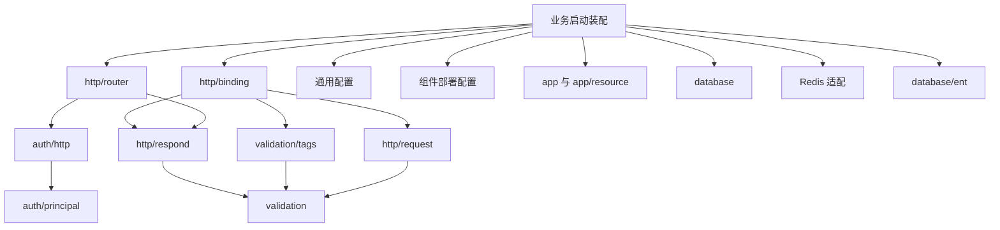

# 整体架构设计

frame 的目标是让业务复用服务运行所需的机制，同时让业务规则保持独立。包按能力划分，依赖在程序入口显式装配；不建立全局服务定位器，不靠 init 注册资源。

本文件说明包依赖、输入输出契约、资源所有权和业务分层。设计取舍和运行流程见[设计说明](design.md)，组件入口见[能力目录](packages.md)。

## 包边界与依赖方向

包围绕实际能力组织，编译依赖由架构测试约束。底层能力不反向导入启动装配，具体驱动、
协议和 SDK 在适配包内隔离。单 module 共享依赖版本，目录隔离不等于独立发布。

| 职责 | 包 | 边界 |
|---|---|---|
| 独立基础能力 | id、optional、pagination、validation、concurrency | 独立消费，不依赖协议、驱动或启动装配 |
| 通用配置 | config、loader、dotenv、yaml、reload | 解码、来源、诊断、快照，不包含部署模型或身份约定 |
| 应用运行 | app、app/resource、app/command | app 核心独立；资源适配所有权，命令只分发回调 |
| 启动约定 | app/config、app/startup | 部署设置按组件组合，日志启动只消费身份与日志设置 |
| HTTP | http/server、client、router、middleware、request、binding、respond、httperror、health | DTO、VO、路由与错误映射属于协议适配 |
| SQL 与 Redis | database、mysql、postgres、ent、query、audit；独立 redis | SQL 核心不导入驱动或 ORM，Redis 不套用 SQL 事务契约 |
| 运行支撑 | cache、lock、schedule、health、identity | 适配借用资源；健康报告不依赖 HTTP，调度不自动选择分布式锁 |
| 身份与观测 | auth、telemetry | 值模型与适配隔离，日志不依赖 OTel，HTTP 认证不选择 token 实现 |
| 工程工具 | cmd/frame、internal/dev、internal/consumer、scripts | 不进入公开运行能力的依赖链 |

根包只提供库说明，不提供资源查询容器或符号别名。业务入口持有具体资源，分别注入
消费者定义的小接口；显式 SQL 事务和双写接线见 [事务示例](../examples/transactions/README.md)。

`app` 负责启动顺序、失败回滚、排空与逆序清理，不导入配置、资源或启动适配子包。
`app/resource` 将打开、探活与关闭接入 Hook。具体连接和健康报告由业务 bootstrap 组装。
Redis Pool 拥有原生客户端，缓存、租约与指标适配借用，不重复关闭。

`config` 保存 Decode、Prepared、Source、Result 和安全诊断契约。部署验证器通过
`config.Invalid` 与 `PrefixValidation` 返回规则；解码器检查声明字段并保留来源，
不泄露输入或自定义错误。`app/config` 提供可独立验证的组件设置，Config 是可选完整预设。
模板自己组合部署模型；未启用的 SQL/Redis 不执行业务约束验证，所有显式输入仍执行
类型、大小和有限值检查。数据库驱动与 URL 由业务选择，不建立驱动白名单。

`app/startup` 复用加载诊断、日志构造、运行结果记录与日志关闭；业务回调组装资源、用例
和路由。信号与退出码由消费程序管理。配置预检不连接资源，正式启动才连接、探活并回滚。
热重载只更新显式允许的快照字段，不自动重建连接池。

`templates/service` 是独立消费 module。验收复制模板，在受控临时副本接入工作区代码。
框架不规定业务必须采用哪种目录，也不提供工程生成器。开发 CLI 和 Ent 代码生成属于
工程工具；只有依赖成本或发布周期实际分化时才拆 module。

完整导航见 [能力目录](packages.md)。包路径和配置 API 以 v0.2.0 为基线；
当前启动装配能力与独立模板采用 v0.2.6，工作区联调和远程标签消费分别验收。

### 装配与依赖边界的验证

新服务以服务模板的装配方式为准。需要借用已启动资源的组合 Hook 应显式声明
`DependsOn`。资源就绪后构造完整路由和服务，再通过 `Group.Add` 注册。
框架管理已注册服务和资源 Hook 的生命周期，业务 bootstrap 负责选择驱动、连接业务依赖
以及登记额外资源的清理。[分类示例](../examples/business/internal/bootstrap/app.go) 展示同样的装配方式。

普通业务入口优先用 `Route.Bind` 和 `Collect` 验证功能内的声明。认证服务由 bootstrap
汇总声明交给 `NewAuthenticated`，检查整体路由与认证策略。直接使用 chi 注册健康、
指标或特殊协议入口时，调用方负责检查路径冲突及访问策略。

根模块的架构测试检查生产包的传递依赖，其中部分核心采用依赖白名单，适配包按职责
配置依赖禁则。业务用例的标准库边界目前由分类、档案和设备同步示例覆盖。
服务模板是独立 module，应另外执行模板或独立消费验证。发布时再验证指定 GitHub
版本可在无本地 `replace` 的工程中消费。

## 业务侧如何分层

库按公共能力组织，业务工程按功能聚合。独立业务模板将 `internal/greeting` 用例与其
`http` 适配子包分开（包名 greetinghttp），保证用例
不引入 HTTP 或框架依赖。bootstrap 持有类型化资源，在资源启动完成后的组合 Hook
中解析句柄、构建 service/store 并注册路由；随后 HTTP 才开始服务。见
[模板说明](../templates/service/README.md)。

分类契约示例采用相同方向：`examples/business/internal/category` 放业务值、模型和用例，
其 `http` 子包放请求 DTO、响应 VO、路由、Handler 和错误映射，`store` 实现持久化接口。
`internal` 是 Go 导入可见性边界，不是业务层名称；消费项目可按团队规范选择业务根目录。
VO 在示例中表示响应视图对象；DAO/store 表示持久化适配，业务值对象使用具体业务名称。
示例用途见[导航](../examples/README.md)。

小模块可以放在一个 feature 包中，按文件分离 HTTP 与业务逻辑，例如：

```text
cmd/api/main.go                   配置、信号、依赖装配
internal/greeting/http.go         路由、请求解码、HTTP 错误映射
internal/greeting/service.go      用例、业务类型、消费者所需接口
internal/order/service.go         订单规则与事务边界
internal/order/mysql_store.go     具体 SQL，实现消费者定义的接口
```

只有在模块复杂到需要明确编译依赖约束时，再拆成 domain、application、adapter 子包。两个文件能讲清楚的小模块不必套多层空目录。

- Handler 负责协议：解码、校验输入格式、调用用例、将领域错误映射为 `httperror.Error`。
- Service 接收 `context.Context` 和业务参数；不接收 `http.ResponseWriter`、全局容器或整个 Config。
- 接口由使用方定义，包含实际需要的方法；避免为了 mock 把每个类型变成接口。
- Repository adapter 负责 SQL、缓存或远端协议；业务需要跨多个存储操作的原子性时，由用例协调事务，框架不猜测事务边界。
- 业务模型和 HTTP DTO 在需要不同语义时分离；不强制简单响应增加一套机械转换。
- 构造函数做静态校验；外部资源连接与探活放入受管理的启动阶段。启动失败应关闭已创建资源；服务排空后才释放它们。

业务 Entity、值对象、查询投影与 DTO 的具体文件归属见[建模指南](modeling.md)。普通路由优先复用已有 binding，完整类型和构造错误传播见[业务入口示例](business-integration.md)。业务测试主要验证规则、权限和数据一致性；通用解码与响应机制由 frame 验证，应用仍保留少量公开端点、审计资源和身份映射契约测试。

业务接入优先收敛以下边界，而不是增加新的容器或业务基类：

- 一条请求路径只有一个完整框架 router。认证入口已经包含 trace、日志和超时；共同设置
  通过 `AuthenticatedOptions.Router` 传入。资源就绪后再构造完整 HTTP 服务并加入 Group。
- 普通 DTO 在启动期通过 binding/Collect 编译，解码后执行一次字段校验。特殊签名、流式协议
  和自定义 JSON 语义保留显式适配，迁移前验证未知字段、null、ID 与错误响应的原有契约。
- 认证后的业务会话信息可由 `AuthenticatedPhase` 中间件校验并放入请求 context，供下游
  复用；会话状态、客户端来源和失效规则由业务定义，不能用跨请求缓存削弱撤销检查。
- 读查询与写入一致性边界分别声明。同步版本推进、全局计数器锁、账本权限锁属于业务事务；
  框架仅执行明确的 SQL/Ent 事务，不自动给每次查询增加写锁或重试。调整锁范围前由业务
  测试证明并发写入、撤权与同步读取的一致性，再用实际数据库验证竞争情况。

MQ 消费、Nacos 配置源和对象存储不作为当前架构扩展目标；只有实际接入需要形成稳定的
通用契约时再评估独立适配。业务任务状态机、补偿及持久化进度继续由业务维护。

示例 [`greeting`](../examples/basic/internal/greeting/service.go) 按文件分离这些责任；[`basic/main.go`](../examples/basic/main.go) 展示显式装配。

完整数据访问示例 [`records`](../examples/records/README.md) 使用服务层拥有的 Repository／Transactions 接口，SQL adapter 实现查询及双写事务，启动 hook 在数据库就绪后完成注入。示例表由运维显式创建。观测示例 [`observability`](../examples/observability/README.md) 展示 exporter、采样、路由标签及清理预算内的刷新。

## 公共方法放在哪里

进入框架的方法至少应满足：多服务会重复使用、有明确语义、可独立测试、有清楚的资源所有权和错误行为。不要为标准库一行调用创建另一套 API，也不要建立 utils/common/base 杂物包。

| 常用需求 | 入口 | 行为边界 |
|---|---|---|
| 配置预检与解码 | `config.Prepare`、`Prepared.Decode`、`config.Decode` | 预检结构与默认值；来源合并后才执行业务 Validate |
| 启动来源组合 | `config/loader.New`、`Load` | 显式文件、环境快照与 CLI；不启动资源、不修改进程环境 |
| 启动日志所有权 | `app/startup.Run` | 共用加载、日志创建、错误记录与关闭；业务持有资源装配 |
| 声明式请求 DTO | `request.Prepare`、`binding.Query/JSON/Path/JSONWithPath` | 编译输入名称/默认值/状态，组合值规则和强类型 handler；不扫描控制器 |
| HTTP 入口声明 | `router.Route.Bind`、`Collect`、`NewAuthenticated` | 保留构造错误；启动前拒绝同方法的重复路径与等价模式覆盖，合并模块后再检查；不同匹配器的语义交集由应用评审 |
| 表单与流式文件 | `binding.Form`、`binding.PrepareMultipart`、`request.StreamMultipart` | 字段复用声明式校验；文件由每请求业务回调暂存，完整校验后提交；请求错误时业务负责回滚 |
| XML 协议接入 | `request.ReadXML/DecodeXMLBytes`、`binding.PrepareXML/XML`、`respond.XML/Text` | 原生 xml 标签、有界解码、原始报文供验签；XML 为值校验，不支持 JSON 的默认值与存在性；微信签名/解密归业务 |
| 低层 query/path DTO | `request.DecodeQuery`、`DecodePath` | 显式平铺标签，不自动执行 d/v |
| 请求 JSON 解码、大小限制、验证 | `request.DecodeJSON` | 入站协议工具；业务约束仍由业务决定 |
| 运行时配置快照 | `config/reload.Manager`、`Watch` | 消费方声明动态字段、克隆和校验规则,可选 `Diff` 声明路径词汇、`Update` 返回变更路径集；只监听显式文件，不自动重建连接池 |
| 独立业务工程 | `templates/service` | 业务或 AI 调整 module/import 和具体框架版本；独立 module 验收，不提供工程生成器 |
| 开发代码重启 | `cmd/frame dev` | 构建成功后切换进程；开发工具隔离在 `internal/dev`，不进入业务运行时依赖 |
| 响应、业务错误、时间字段 | `respond.Adapter`、`httperror.Error`、`respond.MillisTime` | HTTP 层使用；分页统一采用 pagination 值模型，HTTP 入口负责参数/错误映射 |
| 分页请求与结果 | `pagination.NewWindow`、`NewPage`、`NewSlice` | 普通 Page 固定五个字段；无总数使用独立 Slice，多查一条 |
| 创建/更新审计元数据 | `audit.New`、`Fields.WithUpdate` | 显式 Actor 与 UTC 毫秒时间；不处理权限、事务、完整审计历史或并发版本 |
| SQL 排序与分页后缀 | `database/query.OrderBy`、`LimitOffset` | 严格列白名单、显式方言和参数起点；业务负责查询主体和唯一排序声明 |
| 数据库事务 | `database.DB.WithTx`、`database/ent.WithTx` | 显式 SQL/Ent 事务；成功提交，错误／panic 回滚；不做事务自动重试 |
| 声明式字段校验 | `validation/tags.Prepare`、`Prepared.Validate` | 完整有序 Issues、自定义 Context；HTTP 仅首条安全消息，schema 错误为内部错误 |
| 部分更新字段 | `optional.Field[T]` | 未传、null、具体值分离；业务决定可写列与可空规则 |
| Ent 连接适配 | `database/ent.New` | 借用 SQL 池，安全日志；原生 Ent 事务，不导入具体数据库驱动 |
| Ent 建模约定 | `IDMixin`、`CreatedMixin`、`AuditMixin`、`NewIDHook`、`NewAuditHook` | 审计 runtime hook 一次注册，通过生成接口识别标准 Mixin；身份 ID/Name 自动填充，不配置表名、不自动迁移 |
| Ent 分页、排序与错误分类 | `database/ent.QueryPage`、`QuerySlice`、`NewSorter`、`Sorter.Resolve`、`ErrorClassifier` | 泛型列表执行器复用已过滤 query，多查一条推导 has_more；排序走类型化白名单；错误分类只返回类别并保留原始错误，公开文案由业务决定 |
| 连接池与探活 | `mysql.Open`、`postgres.Open`、`database.Open`、`redis.Open` | 适配包解析 DSN，核心接收 connector；显式所有权；Redis 默认关闭命令重试 |
| 资源启动、检查、清理 | `resource.New` 的 Hook/Probe/Value | 按启动顺序装配；不是全局依赖注册表 |
| 模块启动依赖（v0.1.3） | `app.Hook.DependsOn` | 启动前编译稳定拓扑序，缺失/重复/循环依赖阻止启动；服务排空后反向清理，失败 Hook 的部分初始化也回滚 |
| 共享执行预算（v0.1.3） | `concurrency.NewExecutor`、`Do/Shutdown/Stats` | 默认并发快照 GOMAXPROCS；运行/等待数量和时间显式预算，关闭准入后排空；不改全局 CPU 配置，不产生隐式后台任务 |
| 多服务与后台任务 | `app.NewGroup`、`Group.Add`、`app.NewTask` | 可先创建空 Group，在资源就绪的组合 Hook 中注册服务；Run 时仍为空则失败，Run/停机后冻结；关键成员退出触发整体排空，Group 不推断依赖停止顺序 |
| 组合期资源回收 | `app.Cleanup.Add/Stop` | 零值可用，Stop 接入组合 Hook；逆序执行、逐项隔离 panic 并聚合错误、重复停止复用结果；无资源查询与自动注入 |
| 可信代理客户端 IP | `request.NewClientIPResolver`、`ClientIP` | 显式 IP/CIDR，默认只取直接对端；有界 XFF 链从右向左检查，不作身份依据 |
| 本地定时任务 | `schedule.New` | 间隔毫秒、五字段 Cron 显式时区；默认同任务不重叠、不补跑、不自动重试；多副本默认分别调度 |
| Redis 租约 | `lock/redis.New`、`Locker.Acquire` | 借用连接、持有者检查、自动续期可选、失锁取消；释放等待受各自 context 限制，后台清理可能继续到原命令期限 |
| 批量与并发准入 | `concurrency.Map`、`NewBoundedLimiter`、`middleware.Admission` | 固定 worker、有序结果、失败取消；显式等待数量/时间上限与过载拒绝，非分布式配额；旧 NewLimiter 等待数无界 |
| 可降级依赖健康 | `health.Check.Optional` | 可选失败返回 degraded；独立探测池，启动失败策略仍由应用决定 |
| 出站 JSON 请求 | `httpclient.DoJSON`、`DoJSONRequest` | 有限响应读取、统一状态错误、自动关闭响应体；调用方决定业务错误映射 |
| 原始出站请求／流式消费 | `httpclient.Client.Do` | 调用方负责关闭响应体，仍受客户端超时约束 |
| 指标方法标签 | `middleware.MetricMethod`、`RequestEvent.MetricMethod` | 标准方法或 `_OTHER`；原始 Method 仅用于日志等非指标场景 |
| 请求关联与日志 | `trace.IntoContext`、`trace.ValidID`、`logger.FromContext` | 出入站共享格式校验；关联 ID 不是标准分布式 span，也不是可信身份 |
| 标准 HTTP 链路与日志关联 | `telemetry.New`、Adapter.Handler/Transport、`LogHandler` | 显式注入 OpenTelemetry provider，使用 W3C 传播；SDK/exporter 由应用关闭 |
| 请求延迟指标 | `metric.NewRequestRecorder`、`RequestRecorder.Observe/Prometheus`、`metricotel.NewRequestRecorder` | 零依赖定桶直方图,键控 (路由模板, 标准方法) 上限 512;文本导出由业务自挂端点;OTLP 双写为可选绑定 |
| 资源占用指标（v0.1.3） | `metric.NewResourceRecorder`、`Snapshot/Prometheus`、`metric.SQLPool`、`metricredis.Pool` | 按抓取采样 Go 堆/GC/goroutine、Windows/Linux 进程 CPU/RSS 和固定名称连接池，不启动采样协程；Redis 驱动在可选子包 |
| 规范 ID 传输（v0.1.3） | `id.ID`、`id.Parse`、`ID.Int64` | JSON 字符串保留 int64 精度；request/binding 统一 JSON/query/params/form 的规范十进制转换，业务定义是否必须正数 |
| 中间件装配（v0.1.3） | `router.Middleware`、`Group`、`Policy`、`binding.Intercept/InterceptPair` | 应用/分组/路由三层启动期排序；Response 包围匹配请求，Matched/AuthenticatedPhase/BeforeHandler 固定边界；DTO 拦截器在校验后、序列化前执行，不缓存流式响应；禁止匹配后改写目标继续分发，允许标准 HTTP 重定向 |
| 实例与日志路径 | `identity.New`、`Metadata.LogPath` | 每实例隔离；不是 Snowflake 节点分配器 |
| 有序整数 ID | `id.NewSnowflake`、`NextContext` | 显式配置 ID_NODE 并保证节点唯一；records 使用 BIGINT，JSON 输出字符串；见 [节点部署约束](../id/README.md) |

其他编码、哈希、集合、字符串、日期工具优先使用标准库。不得用打印后吞错、万能 recover、忽略 context 的 goroutine 或泛型自动重试来掩盖业务处理责任。

## 使用约定

OpenAPI 契约、文档工具和 SDK 由业务层定义和维护，不纳入 Frame 能力包；
框架不为文档导出建立接口 DSL、自动扫描或改变请求/响应模型。

资源由 Hook.Start 创建并探活，成功后 Value 才可用；Probe 回调可选，健康检查在入口装配。未启动、启动失败、退出后的 Value 均返回错误。工厂返回部分资源和错误时，App 的回滚仍会关闭部分资源。资源实际关闭能力取决于具体 Close 实现，框架不强行终止回调。业务可以在后续初始化 Hook 中获取资源并构建 service/repository，或注入明确的 provider；不要把 Resource 当作跨业务服务定位器。

出站 HTTP client 按上游或共享策略复用，不要每请求创建。总超时覆盖读取响应体；不要为了 SSE 下载等长期请求直接放大所有上游的超时。DoJSON 用于有界 JSON 交互；需要定制请求头和签名时使用 DoJSONRequest；Do 用于调用方管理 body 的场景。默认不跟随重定向、不增加应用级重试；标准 Transport 的透明重放不构成 exactly-once 保证。错误文本不包含远端响应体和 URL 查询凭据，原始诊断原因只在受控范围内查看。

v0.2.2 新增 `httpclient.OperationError` 与 `Stage`，用于判断编码、请求构造、传输、读取、解码和关闭失败；
响应超限通过 `ErrResponseTooLarge` 判断，非 2xx 继续使用 `StatusError`。这些分类保留原始 cause，
不决定业务重试或公开错误码。`OnRequest` 仅观察到响应头；需要包含解码及业务信封校验的结果时，
由业务强类型 client 记录完整调用，参考 [profile/upstream](../examples/business/internal/profile/README.md)。

指标使用 MetricMethod 与 Route 模板；不要加入 trace_id、用户 ID、完整 URL、原始自定义 method。httpclient 对外暴露的是普通 Go error，HTTP handler 自行映射为公开错误文案。

## 扩展边界

新增依赖和能力由实际复用场景驱动；要求明确输入限制、取消语义、资源所有权和独立消费验证。当前使用单 Go module，可选适配器按包隔离；只有依赖成本或发布周期实际分化时才评估拆分。注册中心、权限框架、自动租户隔离、OpenAPI 生成和通用业务工作流不属于基础库职责。

## DTO、校验与持久化

request 编译名称、默认值、类型和存在性，不依赖 tags/Ent；validation 定义公开 Issue、完整 Errors 与 Context，不依赖 HTTP；tags 使用第三方规则引擎；binding 是组合层，连接 request、tags 和 respond。响应只取首条安全消息，不输出完整诊断列表。缺失信息来自绑定器，不能从业务值的零值反推。

普通 JSON 请求按 path/query/body 分开 DTO，正文直接为业务字段；输出由 respond 统一 code/data/message/success/timestamp/traceId，业务 DTO 只定义 data。启动期 Prepared、规则和 handler 可复用，请求期 DTO 与 presence 状态独立创建。binding 的双来源组合共享准备算法，不增加 Meta 专属解码器或规则执行器；低层 Prepared/Adapter 保留给专有输入时序。

业务按 feature 维护公共纯值规则、请求/响应 DTO、Ent Schema。依赖方向为 DTO → 公共规则 ← Ent Schema；不在请求时遍历 Ent 描述符，也不增加全局 Schema DSL。Set/Clear 与响应白名单由业务显式编写，框架不生成 DTO mapper，不把持久化实体当作任意接口输入。授权与 I/O 仍在服务层。

## 核心依赖与声明所有权

以下为关键依赖子图，箭头表示导入；标准库、内部工具与观测依赖省略。实际传递依赖由 [架构测试](../internal/architecture/dependencies_test.go) 检查，覆盖根入口与全部能力目录。



HTTP 方法、路径、Public 与 Operation 由 router.Route 拥有；输入名称、类型、默认值和规则由来源 DTO 拥有；业务 Command/Query/Result 拥有业务含义。Route.Bind/Collect 在启动时组合这些声明，构造失败返回错误，不挂载部分声明。显式类型化注册为主入口；示例组合助手不另建公共 API。

request.Prepared、tags.Prepared 和 binding handler 在启动时准备并复用；DTO、FieldState、validation.Context、Issue 和操作记录按请求创建。path/query/body 使用独立 DTO，路径先于第二来源；可收集问题按来源顺序合并，硬错误或取消阻止后续阶段。默认值仅应用于缺失字段，不覆盖显式零值。

普通请求链为认证 → 解码与传输校验 → Handler 转换业务输入 → Service → Repository/DAO → 业务结果 → 响应 VO。主体来自认证 context，不能来自正文。创建入口需要“父资源记录先于正文”的审计时，使用 Prepared/Adapter 显式编排，随后记录创建结果；普通 JSONWithPath 不能代替这个顺序。

## 输入输出与失败契约

| 契约 | 语义 |
| --- | --- |
| 请求结构 | path/query/body 分别声明 DTO；JSON 正文直接表达业务字段，没有框架级请求信封 |
| 部分更新 | optional.Field 区分省略、null 和值；业务决定可空政策，Field 禁止作为响应序列化 |
| 标识符 | HTTP 保留原始字符串用于规范格式校验；大整数 ID 输出十进制字符串 |
| 普通 JSON 响应 | code、data、message、success、timestamp、traceId；timestamp 为 Unix 毫秒，HTTP 状态与业务 code 分开 |
| 普通分页 | current、size、total、pages、records；空 records 为数组 |
| 无总数分页 | current、size、has_more、records，使用独立 Slice |
| 字段错误 | 内部保留完整 Issues，HTTP 只输出首条公开消息和 null data |
| 预算与 schema | respond 对原始 ErrLimit 返回安全 400；binding 标签工作量预算及 JSON 结构/正文限制按入口契约返回 413；静态/运行时 ErrSchema 属内部错误 |
| 业务错误 | httperror.Error 显式分离公开消息与内部 cause；MapError 只映射业务回调，nil 映射不吞错，未知内部原因不公开 |
| 子操作超时 | 保留显式 HTTP 错误，否则内部 500；自定义校验的子取消/超时不公开 joined 内部诊断 |
| 请求取消/超时 | 请求自身取消不追加写出；请求自身超时在未提交时为 504，已提交不追加包络 |
| 特殊输出 | XML、文件和流式输出使用专用入口，不强制 JSON 信封 |

router.NewAuthenticated 默认 fail-closed。其健康探针需显式公开 GET/HEAD，仍受保护时启动告警；router.New 本身不添加认证。普通认证服务由各 feature 返回 Route.Bind/Collect 声明，在 bootstrap 汇总后通过 NewAuthenticated 的 Routes/Groups 一次编译，并在开始服务前完成注册。后补和嵌套挂载作为原生组合入口仍受政策检查，但后补路由不进入启动目录；需要完整命名阶段与操作元数据的业务入口使用声明路径。路由声明的公开性不等同于业务授权，Service 仍保护非 HTTP 调用的权限、状态和业务不变量。

Prepared JSON 不承诺调用 DTO 的自定义 UnmarshalJSON；低层 DecodeJSON 保留原生自定义解码，并共享重复键与结构预算预检。原始格式、跨字段规则和业务授权分别由合适的输入校验与 Service 负责。

## 资源与事务所有权

多个数据库由业务组装层显式命名和选择，构造适配器时传入对应连接池。事务适配器使用该池的 WithTx；资源打开、探测和关闭由 app/resource 钩子管理。

database.Executor 为池和 SQL 事务共享的执行接口。一个原子用例中的多个仓储必须收到同一个事务执行器；context 只传递取消和观测，不自动绑定事务。Rows 由调用方关闭；回调结束后不能保留事务。Ent 使用当前事务生成客户端，不能用相同 context 代替相同 tx。

事务成功提交，回调失败或已知取消回滚，panic/Goexit 尝试清理并继续传播。回调失败与 context 取消同时发生时，两个原因均保留。提交结果不明不能自动重试；SQL Commit 后事务可能已终结，Ent 的提交 hook 可能在实际提交前失败，因此两者清理行为遵循各自生命周期。清理时只忽略最终指向 sql.ErrTxDone 的单条包装链；复合错误完整保留，避免丢失独立的回滚钩子失败。再次 WithTx 不自动加入已有事务，不提供 savepoint、跨 DB 原子性或 Redis 回滚；幂等、outbox 和补偿由业务选择。

[档案更新示例](../examples/business/internal/profile/README.md) 将操作者、目标用户和授权依赖分开，
由用例保护目标权限，再由 SQL 适配器在同一事务内更新档案和变更记录。
[设备同步示例](../examples/business/internal/devicesync/README.md) 将持久化接收与远端完成分开；
有界内存队列仅保存待处理 ID，满载或进程退出后可从业务存储恢复。
远端成功而本地确认失败时仍可能重放，接收端原子幂等是该业务契约的前提。
这两类组合保持在业务示例中，不引入框架级权限模型、事务后自动副作用或通用工作流。

数据库驱动、连接 URL、Schema 和迁移归业务。通用配置不维护驱动白名单或解析连接 URL；PostgreSQL 为默认推荐，消费项目按实际需要选择适配器、connector 和方言迁移。Redis 使用原生客户端，Pool 拥有连接，缓存、租约与指标适配借用；后端故障不自动降级为 miss。Pipeline 不保证原子性，TxPipeline 和 Lua 也不提供业务错误回滚。

Hook Start/Stop 的 panic 转为 PanicError，启动失败包含半初始化资源的逆序清理；单个 Stop 失败不截断其余清理。OnShutdown 通知的 panic 同样保留诊断，服务排空和逆序资源清理继续执行。App 和 Group 调用 Service.Run/Shutdown/Close 时也保留 PanicError；Shutdown 失败后尝试 Close，Close 失败仍继续其余清理，各阶段错误合并返回。Group 在子服务回调所在 goroutine 内恢复，Close 的失败诊断按成员缓存；回调自行创建的 goroutine 不在恢复范围内。等待 Run 仍受排空预算约束，回调须配合 context，Close 须及时返回。schedule 的实际关停取消为 Canceled，独立错误仍 Failed。日志归档使用单 worker 和有界队列，队列满时背压，Close 等待维护结束；错误可观测，不承诺写入永不阻塞。
